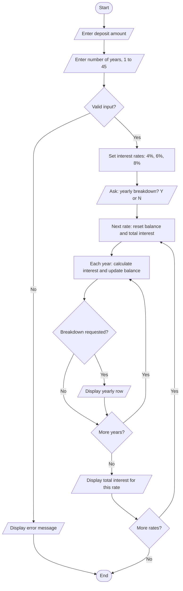

# 📝 KiwiSaver Calculator: Requirements, Flowchart & Pseudocode

**Course:** CIT 506, Programming Essentials · Assessment 1 (planning)

> This is the planning stage. The finished program is on the next page: [KiwiSaver Lump Sum Calculator (Python)](05-cit506-kiwisaver-calculator.md).

## Purpose
I designed a program that projects the earnings from a lump-sum KiwiSaver contribution, so an accountant can show clients clear, data-driven estimates of future savings. KiwiSaver is New Zealand's long-term retirement savings scheme, and returns vary by fund type. The program models three standard annual rates:

| Fund type | Annual return used |
|---|---|
| Conservative | about 4% |
| Balanced | about 6% |
| Growth | about 8% |

For example, a client depositing $5,000 for 10 years at 6% would earn $3,954.24 in interest. This is the kind of result a simple tool can show quickly.

## User requirements
The accountant needs a simple, accurate tool that calculates projected earnings from a lump sum over a period the user chooses, shows the result at all three rates, and optionally shows a year-by-year breakdown.

| | Requirement |
|---|---|
| **Inputs** | Initial deposit (a positive number) · number of years (a whole number from 1 to 45) · optional yearly breakdown (Y/N) |
| **Processes** | Validate inputs · calculate compound interest at 4%, 6% and 8% · loop through each year · add up total interest · store breakdown records if requested |
| **Outputs** | Total interest earned at each rate · optional table of starting balance, interest earned and ending balance for each year |

**Example:** for a $10,000 deposit over 20 years, the program should output the total interest at each rate and, if requested, a table of yearly balances.

## Program flow
This is the program logic redrawn from my pseudocode. (The original flowchart, with its legend, is in the assessment.)



The flowchart uses standard symbols: ovals for start and end, parallelograms for input and output, rectangles for processes and diamonds for decisions.

## Pseudocode
Pseudocode turns the flowchart into a language-neutral description that can be translated into any programming language.

```text
BEGIN PROGRAM

    DISPLAY "Enter initial deposit amount:"
    INPUT deposit

    DISPLAY "Enter number of years (1-45):"
    INPUT years

    IF deposit <= 0 OR years < 1 OR years > 45 THEN
        DISPLAY "Invalid input. Please try again."
        TERMINATE PROGRAM
    END IF

    interestRates ← [0.04, 0.06, 0.08]

    DISPLAY "Would you like a yearly breakdown? (Y/N):"
    INPUT breakdownChoice

    FOR EACH rate IN interestRates DO

        startingBalance ← deposit
        totalInterest ← 0

        IF breakdownChoice = "Y" THEN
            DISPLAY "Interest earned for a", years, "year deposit at", rate * 100, "%"
            DISPLAY "Period # | Starting Balance | Interest Received | Ending Balance"
        END IF

        FOR period ← 1 TO years DO

            interestReceived ← startingBalance * rate
            endingBalance ← startingBalance + interestReceived
            totalInterest ← totalInterest + interestReceived

            IF breakdownChoice = "Y" THEN
                DISPLAY period, startingBalance, interestReceived, endingBalance
            END IF

            startingBalance ← endingBalance

        END FOR

        DISPLAY "Amount deposited:", deposit, "at", rate * 100, "% per annum"
        DISPLAY "Total interest received over the", years, "year term:", totalInterest

    END FOR

END PROGRAM
```

The loop calculates interest once per year, and each year's interest is added to the balance before the next year starts. That is how compound interest works.

## From plan to finished program
Writing the code showed where the plan could be improved:

| | Plan (pseudocode) | Finished program (Python) |
|---|---|---|
| **Invalid input** | Shows an error and terminates | Re-prompts until the user enters a valid value |
| **What is checked** | Deposit and years against numeric limits | Also rejects text, symbols, commas, spaces, empty input and decimal years without crashing |
| **Structure** | One block of logic | Separate functions: `validate_float`, `validate_int`, `calculate_growth` |
| **Breakdown** | Printed as each year is calculated | Stored as records, then printed after the calculation |

## Future enhancements I identified
- Inflation-adjusted projections
- Tax and fee calculations
- Comparing multiple deposit scenarios
- Graphs of growth over time
- Fund types beyond the three fixed rates
- Exporting results to PDF or Excel for client reports

**Tools / topics:** requirements analysis · flowcharting · pseudocode · algorithm design · compound interest

---

[⬅ Back to my profile](../README.md)
